::: {.meta-topico}
<dl>
<dt>Competências</dt>
<dd>Compreender e aplicar a rastreabilidade entre requisitos, elementos arquiteturais e artefatos do desenvolvimento de software.</dd>
<dt>Pré-requisitos</dt>
<dd>Engenharia de requisitos e fundamentos de arquitetura de software.</dd>
<dt>Formatos</dt>
<dd>
[texto]{.formato} [notebook](notebook.ipynb){.formato} [áudio](assets/audio/){.formato} [gem](GEM_GEMINI.md){.formato} [slides](slides.qmd){.formato}
</dd>
</dl>
:::

## Definição e contexto

A rastreabilidade de requisitos consiste em estabelecer e acompanhar relações entre os 
requisitos de um sistema e outros artefatos produzidos durante o desenvolvimento, como 
modelos de arquitetura. Essas relações permitem compreender como os requisitos estão 
representados no sistema e apoiam atividades de manutenção e evolução do software [@ballarin2023influence, p. 705].

A necessidade de rastreabilidade aumenta conforme os sistemas se tornam mais complexos. 
Durante o desenvolvimento, os requisitos são transformados em diferentes representações, 
como modelos arquiteturais e código, tornando mais difícil identificar as relações entre 
aquilo que foi especificado e os elementos que foram desenvolvidos. Ballarín et al. (2023) 
destacam especialmente a importância de identificar os vínculos entre requisitos e modelos de 
arquitetura, pois essas relações ajudam os engenheiros a compreender o sistema durante a 
manutenção e a localizar partes que podem apresentar problemas [@ballarin2023influence, p. 705].

Nesse contexto, a rastreabilidade também pode apoiar a análise de mudanças. 
Ao manter relações entre requisitos e elementos arquiteturais, torna-se possível investigar 
quais partes do sistema estão relacionadas a determinado requisito e, consequentemente, quais 
elementos podem precisar ser analisados quando esse requisito é alterado. 
O estudo de Ballarín et al. (2023) evidencia ainda que a linguagem utilizada para representar 
a arquitetura pode influenciar a eficácia da recuperação dessas relações entre requisitos e arquitetura [@ballarin2023influence, p. 705].

Assim, a rastreabilidade não consiste apenas em registrar requisitos, mas em manter 
relações que permitam acompanhar sua representação ao longo do desenvolvimento e da manutenção do software. 
No estudo analisado, diferentes linguagens arquiteturais apresentaram desempenhos distintos 
na recuperação dessas relações, mostrando que a forma como a arquitetura é representada também pode 
influenciar a rastreabilidade [@ballarin2023influence, pp. 705–706].

## Conceitos fundamentais de rastreabilidade

A rastreabilidade pode ser compreendida por diferentes perspectivas, considerando a direção em que 
os relacionamentos são acompanhados e os níveis de desenvolvimento envolvidos. 
Essas classificações ajudam a entender como os requisitos se conectam aos demais elementos de um sistema.

### Rastreabilidade para frente (Forward Traceability)

A rastreabilidade para frente permite acompanhar um requisito até os elementos desenvolvidos a partir dele. 
Dessa forma, é possível identificar quais componentes, funcionalidades e partes da arquitetura estão relacionados 
a determinada necessidade do sistema.

Por exemplo, um requisito que estabelece a necessidade de autenticação de usuários pode ser relacionado 
ao componente responsável pelo login e aos elementos arquiteturais que dão suporte a essa funcionalidade.

### Rastreabilidade para trás (Backward Traceability)

A rastreabilidade para trás realiza o caminho inverso, permitindo identificar 
qual requisito deu origem a determinado componente, funcionalidade ou decisão arquitetural.

Essa relação ajuda a compreender a finalidade dos elementos desenvolvidos e 
verificar se eles possuem uma justificativa nos requisitos definidos. 
Também permite identificar funcionalidades implementadas que não possuem uma necessidade documentada correspondente.

### Rastreabilidade vertical e horizontal
A rastreabilidade também pode ser classificada de acordo com os níveis e artefatos relacionados.

- Vertical: estabelece relações entre diferentes níveis de desenvolvimento, como requisitos, arquitetura, 
  projeto detalhado e implementação. Permite acompanhar como uma necessidade inicial é representada nas 
  diferentes etapas de construção do software.

- Horizontal: estabelece relações entre elementos de um mesmo nível ou entre artefatos relacionados, 
  permitindo identificar dependências e conexões entre requisitos, componentes ou funcionalidades.

Essas duas perspectivas são complementares e ajudam a compreender tanto a evolução de um requisito 
quanto suas relações com outros elementos do sistema.

### Relações entre requisitos e outros artefatos

Os requisitos não existem de forma isolada durante o desenvolvimento. Eles precisam estar relacionados 
aos artefatos que representam sua implementação, especialmente aos modelos de arquitetura e ao código-fonte.

Ballarín et al. (2023) destacam justamente a importância de estabelecer relações entre requisitos e 
modelos arquiteturais, permitindo identificar quais elementos da arquitetura estão associados a 
determinadas necessidades do sistema. Os autores também consideram o código-fonte como outro tipo de 
artefato que pode estar relacionado aos requisitos [@ballarin2023influence, p. 705].

Essa relação permite compreender como uma necessidade especificada se transforma em elementos concretos 
do software. Por exemplo, um requisito relacionado ao processamento de pagamentos pode estar associado 
a um componente arquitetural responsável por essa função e aos elementos de implementação correspondentes.

Dessa maneira, a rastreabilidade mantém uma ligação entre o que foi solicitado e os elementos desenvolvidos, 
contribuindo para a compreensão, a manutenção e a evolução do software [@ballarin2023influence, p. 705].

<!-- ===================================================== -->
<!-- PESSOA 2 - RASTREABILIDADE E ARQUITETURA                -->
<!-- Responsável: conectar requisitos e decisões arquiteturais. -->
<!-- ===================================================== -->

## Rastreabilidade entre requisitos e arquitetura

<!-- PESSOA 2: desenvolver esta seção.

Deve abordar:
- Como os requisitos influenciam a arquitetura do software.
- Como decisões arquiteturais atendem aos requisitos.
- Relação entre requisitos funcionais e não funcionais.
- Como identificar quais componentes atendem a cada requisito.
- Como acompanhar mudanças nos requisitos e seus impactos
  sobre a arquitetura.
- Importância de manter justificativas das decisões arquiteturais.

Utilizar o artigo principal Ballarín et al. (2023) como referência central.
-->

### Relação entre requisitos e elementos arquiteturais

<!-- PESSOA 2: apresentar como os requisitos se relacionam com
decisões arquiteturais, componentes, interfaces e outros elementos.

Exemplo ilustrativo:

Requisito
    ↓
Decisão arquitetural
    ↓
Componente
    ↓
Interface

Explicar cada relação e sua importância.
-->

### Estrutura dos relacionamentos

<!-- PESSOA 2: elaborar pelo menos um diagrama autoral.

O diagrama deve representar o caminho entre um requisito
e os elementos arquiteturais relacionados.

Salvar em:
assets/imagens/rastreabilidade-requisitos-arquitetura.svg

Inserir a imagem nesta seção utilizando:

{#fig-rastreabilidade fig-cap="Representação da relação entre requisitos e arquitetura."}
-->

### Análise de impacto das mudanças

<!-- PESSOA 2: explicar como a rastreabilidade permite identificar
quais decisões, componentes e interfaces podem ser afetados
quando um requisito é alterado.

Apresentar pelo menos um exemplo de alteração de requisito
e suas possíveis consequências arquiteturais.
-->

<!-- ===================================================== -->
<!-- PESSOA 3 - TÉCNICAS DE RASTREABILIDADE                  -->
<!-- Responsável: métodos, links e ferramentas.              -->
<!-- ===================================================== -->

## Técnicas para estabelecer e manter a rastreabilidade

<!-- PESSOA 3: desenvolver esta seção.

Deve abordar:
- Como estabelecer relacionamentos entre artefatos.
- Como registrar e identificar links de rastreabilidade.
- Como manter os relacionamentos atualizados.
- Como identificar links inválidos ou desatualizados.
- Como consultar os relacionamentos durante mudanças.

Diferenciar conceitos de rastreabilidade das técnicas
utilizadas para implementá-la.
-->

### Matrizes de rastreabilidade

<!-- PESSOA 3: explicar o funcionamento de uma matriz
de rastreabilidade e apresentar um exemplo.

A matriz deve relacionar identificadores de requisitos
com decisões arquiteturais e componentes.

Exemplo de estrutura:

| Requisito | Decisão arquitetural | Componente |
|---|---|---|
| REQ-01 | DA-01 | Componente A |
| REQ-02 | DA-02 | Componente B |

Explicar como interpretar e atualizar os relacionamentos.
-->

### Modelos e links de rastreabilidade

<!-- PESSOA 3: explicar os modelos de representação
dos relacionamentos e os diferentes tipos de links.

Apresentar exemplos de relações entre requisitos,
modelos arquiteturais, código e testes.
-->

### Ferramentas de apoio

<!-- PESSOA 3: pesquisar ferramentas utilizadas
para gerenciamento de requisitos e rastreabilidade.

Apresentar:
- Nome da ferramenta.
- Finalidade.
- Principais funcionalidades.
- Como auxilia na manutenção dos relacionamentos.

Não fazer uma lista de ferramentas sem explicar
sua utilidade no contexto do tema.
-->

<!-- ===================================================== -->
<!-- PESSOA 4 - EXEMPLO APLICADO E NOTEBOOK                  -->
<!-- Responsável: caso prático e implementação executável.   -->
<!-- ===================================================== -->

## Exemplo aplicado

<!-- PESSOA 4: desenvolver esta seção.

Escolher um sistema simples para demonstrar rastreabilidade.
O exemplo deve mostrar a relação entre requisitos,
decisões arquiteturais, componentes e testes.

O exemplo precisa ser o mesmo utilizado no notebook.
-->

### Contextualização do sistema

<!-- PESSOA 4: apresentar o sistema escolhido,
seu objetivo e os requisitos que serão acompanhados.

Identificar os requisitos com códigos, como:
REQ-01, REQ-02 e REQ-03.
-->

### Aplicação da rastreabilidade

<!-- PESSOA 4: demonstrar passo a passo:

1. Identificação dos requisitos.
2. Definição das decisões arquiteturais.
3. Associação dos requisitos aos componentes.
4. Registro dos relacionamentos.
5. Identificação dos testes relacionados.
6. Análise de impacto diante de uma mudança.

Utilizar tabelas e diagramas para facilitar a compreensão.
-->

### Cenário de alteração de requisito

<!-- PESSOA 4: demonstrar uma situação em que um requisito
é alterado e explicar como os relacionamentos permitem
identificar os elementos arquiteturais afetados.

Comparar a situação com e sem rastreabilidade.
-->

### Demonstração executável

<!-- PESSOA 4: desenvolver o notebook.ipynb.

O notebook deve reproduzir o mesmo cenário explicado no texto.

Deve conter:
- Apresentação do problema.
- Dados ou requisitos utilizados.
- Construção da matriz de rastreabilidade.
- Consulta dos relacionamentos.
- Simulação de alteração de requisito.
- Identificação dos elementos afetados.
- Resultados e conclusão.

Testar a execução completa no Google Colab.
-->

::: {.callout-note}
## Notebook deste tópico

O notebook está disponível em [`notebook.ipynb`](notebook.ipynb) e pode ser executado pelo Google Colab.

O texto e o notebook devem utilizar o mesmo exemplo, os mesmos identificadores e os mesmos relacionamentos.
:::

<!-- ===================================================== -->
<!-- PESSOA 5 - TRADE-OFFS, DECISÃO E APRESENTAÇÃO           -->
<!-- Responsável: avaliação crítica e integração final.     -->
<!-- ===================================================== -->

## Trade-offs da rastreabilidade

<!-- PESSOA 5: desenvolver esta seção.

Discutir os benefícios e custos de manter rastreabilidade
durante o desenvolvimento do software.

Abordar:
- Melhor análise de impacto versus custo de manutenção.
- Maior controle das mudanças versus esforço de documentação.
- Facilidade de auditoria versus necessidade de atualização.
- Automação dos relacionamentos versus possíveis falsos links.
- Visibilidade arquitetural versus complexidade de gerenciamento.

Utilizar situações práticas, não apenas afirmações genéricas.
-->

### Comparação dos principais trade-offs

<!-- PESSOA 5: elaborar uma tabela comparativa contendo:
aspecto, benefício e custo ou desafio.

Explicar os impactos de cada aspecto no desenvolvimento.
-->

## Quando utilizar rastreabilidade

<!-- PESSOA 5: desenvolver esta seção.

Apresentar critérios objetivos para decidir quando
a rastreabilidade é importante.

### Considere utilizar quando:
- Existem requisitos complexos ou interdependentes.
- Mudanças podem afetar diversos componentes.
- É necessário justificar decisões arquiteturais.
- O sistema exige auditoria ou comprovação de requisitos.

### Avalie a necessidade quando:
- O projeto possui escopo muito pequeno.
- A quantidade de artefatos é reduzida.
- O custo de manutenção dos relacionamentos
  pode superar seus benefícios.

### Sinais de problemas:
- Links desatualizados.
- Requisitos sem elementos relacionados.
- Decisões arquiteturais sem justificativa.
- Alterações sem análise de impacto.
-->

## Conclusão

<!-- PESSOA 5: elaborar a conclusão após receber as contribuições.

Retomar:
- Importância da rastreabilidade.
- Relação entre requisitos e arquitetura.
- Benefícios para manutenção e evolução.
- Principais desafios.
- Importância de escolher técnicas adequadas ao contexto.

Não introduzir conceitos novos nesta seção.
-->

<!-- ===================================================== -->
<!-- PESSOA 5 - INTEGRAÇÃO DOS MATERIAIS                     -->
<!-- Responsável por slides, referências e revisão final.    -->
<!-- ===================================================== -->

::: {.callout-note}
## Slides deste tópico

A apresentação está disponível em [`slides.qmd`](slides.qmd).

Os slides devem apresentar os mesmos conceitos, diagramas e exemplos desenvolvidos no texto e no notebook.

A Pessoa 5 ficará responsável pela organização e revisão da apresentação, garantindo a participação dos cinco integrantes.
:::

## Referências

As referências são geradas automaticamente a partir de `referencias.bib`.

<!-- PESSOA 5: integrar as referências enviadas pelos demais integrantes.

Cada pessoa deve informar:
- Autor e ano.
- Título da publicação.
- DOI ou URL, quando disponível.
- Identificador da citação utilizado no texto.

Não remover referências utilizadas por outros integrantes.
-->

::: {#refs}
:::

::: {.como-citar}
**Como citar este tópico**

[Nome dos cinco autores, na ordem definida no metadata.yaml]. "Rastreabilidade entre requisitos e arquitetura". *Guia Aberto de Arquitetura de Software*, 2026. Licenciado sob CC BY-NC 4.0.
:::
