---
title: "Rastreabilidade entre Requisitos e Arquitetura"
subtitle: "Relações, técnicas e acompanhamento das decisões arquiteturais"
author:
  - "Agdo José Samuel Sousa de oliveira"
  - "Antonio Carlos Verissimo de Souza"
  - "Pedro Henrique Borges Silva"
  - "Felipe dos Santos Silva"
  - "Antonio Pedro Guimarães Santos de Macedo"
date: 2026-11-14
bibliography: referencias.bib
format:
  revealjs:
    theme: default
    css: slides.css
    lang: pt-BR
    slide-number: c/t
    slide-level: 2
    incremental: false
    code-overflow: wrap
    link-external-newwindow: true
    footer: "Guia Aberto de Arquitetura de Software · CC BY-NC 4.0"
---

## Roteiro

1. Problema, requisitos e arquitetura
2. Técnicas e matriz de rastreabilidade
3. Clínica: mudança de `REQ-04`
4. Artigo: abordagem, avaliação e resultados
5. Limites, crítica e relação com o guia
6. Trade-offs, adoção e conclusão

::: {.notes}
Os fundamentos ficam com o primeiro integrante; a relação com a
arquitetura, com o segundo; as técnicas, com o terceiro; a clínica e o
notebook, com o quarto. Na parte final, retomar o artigo, discutir seus
limites e aplicar a crítica aos trade-offs do guia.
Na capa, apresentar os cinco autores na ordem registrada em
metadata.yaml e explicar que Ballarín et al. (2023) é o artigo principal.
:::

## O problema da falta de rastreabilidade

Durante o desenvolvimento de software, os requisitos são transformados em
modelos, componentes e funcionalidades.

- Nem sempre é fácil identificar quais elementos atendem a cada requisito.
- Uma alteração pode afetar diferentes partes do sistema.
- A falta de relacionamentos dificulta a análise de impacto e a manutenção.

::: {.notes}
Imagine que um sistema possui um requisito de autenticação de usuários.
Com o passar do tempo, essa funcionalidade pode envolver diferentes
componentes da arquitetura e partes do código.

Se surgir a necessidade de modificar a autenticação, como saber quais
elementos precisam ser revisados?

Sem relações bem estabelecidas entre os requisitos e os artefatos do
sistema, essa identificação pode se tornar difícil.

É esse problema que torna a rastreabilidade necessária.
:::

## O que é rastreabilidade?

É a capacidade de estabelecer e acompanhar relações entre os requisitos
e os diferentes artefatos produzidos durante o desenvolvimento de software.

```text
      REQUISITO
          |
          v
      ARQUITETURA
          |
          v
     IMPLEMENTAÇÃO
          |
          v
        TESTES
```

- Identifica onde os requisitos estão representados.
- Permite acompanhar sua realização no sistema.
- Apoia a manutenção e a análise de mudanças.

**Referência:** Ballarín et al. (2023).

::: {.notes}
A rastreabilidade permite acompanhar o caminho percorrido por um requisito
durante o desenvolvimento.

Como podemos observar, um requisito pode estar relacionado a uma decisão
arquitetural, a componentes implementados e aos testes responsáveis por
verificar seu funcionamento.

O artigo de Ballarín e seus colaboradores destaca justamente a importância
das relações entre requisitos e modelos arquiteturais, considerando também
a influência das linguagens utilizadas para representar a arquitetura.

Portanto, não basta registrar o que o sistema precisa fazer. É importante
conseguir identificar como essas necessidades estão representadas nos
artefatos produzidos.
:::

## Tipos de rastreabilidade

**Forward Traceability — Para frente**

```text
Requisito ──────────> Implementação
```
Permite identificar o que foi desenvolvido a partir de um requisito.

**Backward Traceability — Para trás**

```text
Implementação ──────> Requisito
```
Permite identificar qual requisito deu origem a determinado elemento.

**Vertical Traceability — Vertical**

```text
Requisitos
    |
Arquitetura
    |
Implementação
```
Relaciona artefatos de diferentes níveis de desenvolvimento.

**Horizontal Traceability — Horizontal**

```text
Requisito A <──────> Requisito B
```
Relaciona elementos de um mesmo nível ou artefatos correspondentes.

::: {.notes}
Existem diferentes perspectivas para compreender as relações de
rastreabilidade.

Na rastreabilidade para frente, partimos de um requisito para identificar
os elementos desenvolvidos a partir dele.

Na rastreabilidade para trás, fazemos o caminho inverso, buscando descobrir
qual requisito está relacionado a determinado componente.

Já a rastreabilidade vertical conecta diferentes níveis do desenvolvimento,
como requisitos, arquitetura e implementação.

A horizontal estabelece relações entre elementos de um mesmo nível ou
artefatos correspondentes.

Essas perspectivas se complementam e ajudam a compreender melhor as
dependências existentes no sistema.

Com esses conceitos estabelecidos, podemos avançar para entender como
essas relações são organizadas e mantidas na prática.
:::

<!-- ================================================== -->
<!-- PESSOA 2 - REQUISITOS E ARQUITETURA                  -->
<!-- ================================================== -->

## Requisitos e arquitetura

- Requisitos funcionais: **o que** o sistema faz.
- Atributos de qualidade (RNFs): **como** o sistema se comporta.
- Decisões arquiteturais existem para **satisfazer** requisitos e atributos de qualidade.
- Ballarín et al. (2023): a linguagem arquitetural escolhida influencia a capacidade de rastrear requisitos.

::: {.notes}
Não basta listar requisitos. A arquitetura precisa materializar esses requisitos em componentes e decisões. A escolha da linguagem já começa a facilitar ou dificultar a rastreabilidade futura.
:::

## Como os requisitos se conectam à arquitetura?

{fig-align="center" height="200px"}

- **REQ-04 → DA-04**: a decisão existe para satisfazer o atributo de qualidade.
- **DA-04 → COMP-02 / COMP-06**: a decisão se materializa nesses componentes.

::: {.notes}
Explique que a seta não é decorativa. "Por que o cache existe?" → por causa de DA-04. "Por que DA-04 existe?" → por causa de REQ-04. A rastreabilidade é a cadeia de respostas a essas perguntas.
:::

<!-- ================================================== -->
<!-- PESSOA 3 - TÉCNICAS                                 -->
<!-- ================================================== -->

## Técnicas de rastreabilidade

- **Vínculo** = origem + tipo + destino, com justificativa,
  versão e situação.
- **Tipos** dão semântica: `satisfaz`, `implementa`,
  `verifica` e `depende`.
- **Captura** registra durante a criação; **recuperação**
  reconstrói o link depois, a partir dos artefatos.
- **Manutenção** contínua ou sob demanda, disparada por
  mudanças em requisitos, decisões, componentes ou testes.
- **Verificação** por cobertura nos dois sentidos,
  integridade referencial e atualidade do vínculo.

::: {.notes}
Não repetir a definição de rastreabilidade: o foco é o como.
Perguntar à turma quem atualiza a matriz quando REQ-04 muda.
Um vínculo sem justificativa e sem responsável não sobrevive
à primeira mudança.
:::

## Matrizes, links e ferramentas

| Requisito | Decisões | Componentes | Teste |
|---|---|---|---|
| REQ-01 | DA-01, DA-04 | COMP-01, COMP-02, COMP-06 | TST-01 |
| REQ-02 | DA-01, DA-02 | COMP-01, COMP-02, COMP-03 | TST-02 |
| REQ-03 | DA-03 | COMP-04, COMP-05 | TST-03 |
| REQ-04 | DA-02, DA-04 | COMP-02, COMP-03, COMP-06 | TST-04 |
| REQ-05 | DA-05 | COMP-01, COMP-06 | TST-05 |

Ler a linha responde "o que muda se este requisito mudar";
ler a coluna responde "por que este elemento existe".

Ferramentas: DOORS e Requisite Pro (gestão), Trace
Maintainer (manutenção), RETRO (recuperação) e a própria
matriz em planilha ou notebook (baixo custo).

::: {.notes}
Percorrer a linha de REQ-04 e a coluna de COMP-02 na tabela.
Mostrar que a ferramenta só ajuda depois que o modelo de
informação, os identificadores e o responsável pela
atualização estão definidos. Evitar listar ferramentas sem
ligar cada uma à atividade que ela apoia.
:::

<!-- ================================================== -->
<!-- PESSOA 4 - EXEMPLO APLICADO                          -->
<!-- ================================================== -->

## Exemplo aplicado: sistema escolhido

**PESSOA 4: desenvolver este slide.**

Apresentar o sistema utilizado no notebook.

Deve conter:

- Contexto do sistema.
- Problema que será resolvido.
- Requisitos identificados.
- Elementos arquiteturais envolvidos.

::: {.notes}
Apresentar o cenário antes de mostrar o funcionamento.
Utilizar exatamente o mesmo exemplo do notebook.
:::

## Demonstração prática

**PESSOA 4: desenvolver este slide.**

Demonstrar:

1. Identificação de um requisito.
2. Associação com uma decisão arquitetural.
3. Relacionamento com um componente.
4. Consulta da rastreabilidade.
5. Alteração do requisito.
6. Identificação dos elementos afetados.

Apresentar capturas ou resultados reais da execução do notebook.

::: {.notes}
Executar ou demonstrar os resultados do notebook.
Mostrar o que acontece quando um requisito é alterado.
Comparar o cenário com e sem os relacionamentos registrados.
:::

<!-- ================================================== -->
<!-- PESSOA 5 - TRADE-OFFS E DECISÃO                      -->
<!-- ================================================== -->

## Artigo principal: abordagem e avaliação

- Ballarín et al. (2023): **11 linguagens arquiteturais**.
- Caso industrial ferroviário da **CAF**, com 16 requisitos.
- Recuperação de vínculos por similaridade textual (**LSI**).
- Comparação com vínculos aprovados; métricas de precisão,
  revocação, F-measure e MCC. [@ballarin2023influence]

::: {.notes}
Explicar a passagem do exemplo da clínica para a pesquisa: o artigo
pergunta se a linguagem usada para modelar a arquitetura influencia
a recuperação automática dos vínculos com requisitos. A equipe da
CAF forneceu requisitos, modelos e vínculos aprovados para comparação.
O procedimento usa a mesma abordagem RTAL baseada em LSI para as
linguagens avaliadas. As métricas avaliam os vínculos recuperados;
não medem o desempenho do sistema da clínica.
:::

## Resultados e limites do estudo

- No caso estudado, linguagens de **propósito geral/pesquisa**
  tiveram os melhores indicadores médios.
- Nesse grupo: precisão média **0,51** e revocação média **0,38**.
- Os autores pedem replicação em outros estudos de caso.
- O parâmetro da LSI foi mantido fixo para comparar linguagens.

::: {.notes}
Precisão é a parcela dos vínculos recuperados que estava correta;
revocação é a parcela dos vínculos corretos que foi recuperada.
Os valores 0,51 e 0,38 são médias do grupo de linguagens de
propósito geral/pesquisa no caso da CAF, não valores da clínica nem
garantia de desempenho em qualquer projeto. A seção de ameaças à
validade reconhece a necessidade de replicação e que a escolha do
parâmetro k na LSI pode influenciar a acurácia [@ballarin2023influence].
:::

## Trade-offs da rastreabilidade

::: {style="font-size: 0.68em"}

| Aspecto | Benefício | Custo ou desafio |
|---|---|---|
| Impacto | Localizar elementos a revisar | Atualizar vínculos |
| Mudanças | Justificar decisões | Documentar motivos |
| Auditoria | Conferir cobertura | Evitar links obsoletos |
| Automação | Sugerir vínculos | Revisar falsos positivos |
| Visibilidade | Ver dependências | Gerir mais relações |
:::

::: {.notes}
Uma mudança para 500 ms em 99% das consultas torna útil localizar
os candidatos à revisão, mas a equipe precisa confirmar quais deles
realmente mudam e atualizar os vínculos. COMP-02 também atende REQ-01
e REQ-02; por isso, considerar regressão de TST-01 e TST-02.
O custo de registrar e manter a rastreabilidade deve ser comparado
ao valor das consultas que ela permite [@ingram2012cost].
:::

## Quando e quanto rastrear

**Registre vínculos quando:**

- Um componente atende a vários requisitos.
- Mudanças alcançam decisões, componentes e testes.
- A equipe precisa justificar decisões ou auditar cobertura.

**Mantenha a matriz enxuta quando:**

- Poucos artefatos respondem às consultas necessárias.
- Uma linha por requisito e IDs estáveis bastam.

::: {.notes}
Na clínica, a planilha ou o notebook com cinco requisitos, decisões,
componentes e testes já responde às perguntas de impacto. Definir
quem atualiza cada vínculo após uma mudança. Se as consultas e os
artefatos crescerem, avaliar apoio automatizado; se uma coluna não
responder a uma pergunta real, não mantê-la por hábito.
Links obsoletos e decisões sem justificativa indicam que o processo
de atualização precisa de revisão.
:::

## Crítica do grupo e aplicação ao guia

- **Força do estudo:** dados industriais e métricas explícitas.
- **Limite:** um caso ferroviário da CAF e uma abordagem baseada em LSI.
- **Decisão para a clínica:** tratar sugestões automáticas como
  candidatas; revisar antes de incluir na matriz.

::: {.notes}
Os autores comparam linguagens com requisitos e modelos fornecidos
pela CAF e medem precisão, revocação, F-measure e MCC. Isso torna a
comparação verificável. Eles próprios pedem replicação em outros casos;
além disso, a escolha do parâmetro k da LSI não foi avaliada. O artigo
não testou o sistema da clínica. Nossa recomendação é usar a recuperação
para priorizar a revisão humana dos vínculos, mantendo a matriz como
registro confirmado [@ballarin2023influence].
:::

## Conclusão

- `REQ-04` mostra o valor de consultar decisões, componentes e testes.
- A consulta reversa revela requisitos que compartilham `COMP-02`.
- Vínculos úteis precisam de IDs estáveis, justificativa e revisão.
- A técnica deve caber no tamanho e no ritmo de mudança do projeto.

::: {.notes}
Retomar o caminho percorrido pelos cinco integrantes: problema,
relação com a arquitetura, técnicas, exemplo executável e escolha
prática. A matriz aponta candidatos à revisão; a equipe decide o
que alterar e mantém os vínculos coerentes depois da mudança.
:::

## Referências {.smaller}

::: {#refs}
:::

::: {.notes}
Ballarín et al. (2023) é o único estudo principal do seminário.
As demais obras fundamentam conceitos e custos de rastreabilidade.
:::
